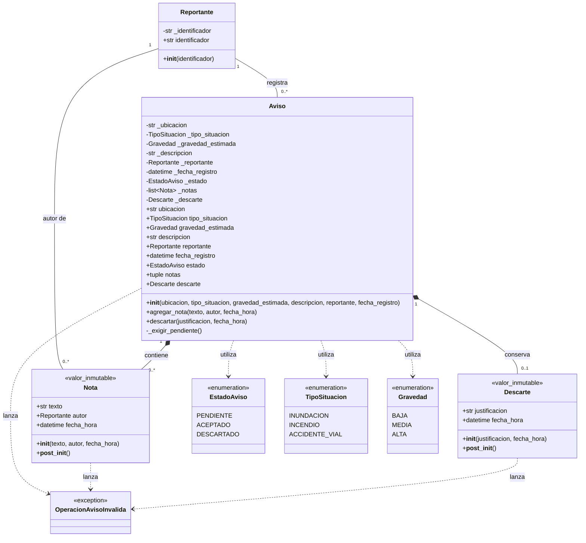
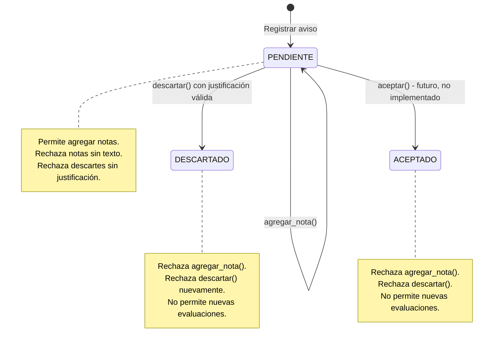

# Avance 1 - Avisos y notas

## 1. Diagrama de clases

## 2. Diagrama de estados

## 3. Tarjetas CRC

### Aviso

**Qué sabe:** ubicación, tipo de situación, gravedad, descripción, reportante, fecha de registro, estado, notas y descarte.

**Responsabilidades:**
- Registrar un aviso en estado pendiente.
- Permitir agregar notas mientras esté pendiente.
- Descartar un aviso con una justificación.
- Rechazar operaciones que no correspondan a su estado.

**Colaboradores:** Reportante, Nota y Descarte.

### Reportante

**Qué sabe:** su identificador.

**Responsabilidad:** representar al reportante de un aviso y permitir consultar su identificador.

**Colaboradores:** Aviso y Nota.

### Nota

**Qué sabe:** texto, autor y fecha y hora.

**Responsabilidades:**
- Conservar los datos de una nota.
- Validar que tenga un autor válido y texto no vacío.

**Colaboradores:** Reportante y Aviso.

### Descarte

**Qué sabe:** justificación y fecha y hora.

**Responsabilidades:**
- Conservar los datos del descarte.
- Validar que la justificación no esté vacía.

**Colaborador:** Aviso.

## 4. Decisiones de diseño

La verificación del autor de las notas será responsabilidad de la clase `Aviso`, porque conoce al reportante que lo registró. Entonces, cuando se agregue una nota, va a poder comprobar que el autor sea ese mismo reportante y, además, que el aviso esté pendiente.

Elegí esta opción para mantener las reglas adentro de la clase y evitar que se puedan agregar notas sin realizar las verificaciones correspondientes. Por ejemplo, si esta comprobación se hiciera únicamente en la capa de aplicación, se podría llamar directamente al método `agregar_nota()` y saltarse esa verificación.